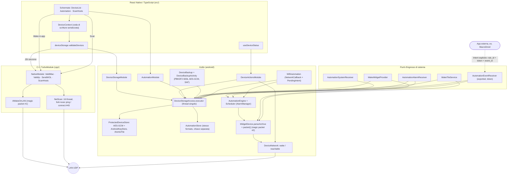
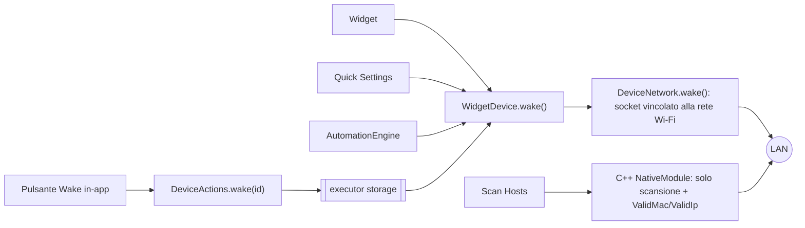

# Revisione tecnica e di sicurezza — AwakeOnLANMobile 1.2.0-rc.3

Data: 2026-11-15 · Commit analizzato: `391e0b7` (main) · Stato: **fase 4 implementata nella copia di lavoro (non ancora committata), verifiche in §9.5**

Ambito letto integralmente: `cpp/`, `specs/`, tutti i sorgenti Kotlin in `android/app/src/main`, manifest, Gradle, workflow CI/CD, `src/` (TypeScript), `tools/dependencies/`, README e note tecniche. Letti a campione: `AutomationScreen.tsx`, `AutomationEditor.tsx`, test e documenti di validazione. Non analizzato: `ios/` (scaffold upstream dichiarato non funzionante).

Legenda certezza: **C** = certo (verificato nel codice o eseguendo un comando) · **P** = probabile (deduzione dal codice, non riprodotta su dispositivo) · **I** = ipotesi da verificare.

---

## 1. Executive summary

Il progetto è in condizioni **buone e sopra la media per un'app di questa taglia**: la superficie di sicurezza (storage cifrato con Keystore, backup PBKDF2+AES-GCM, receiver esportato autenticato da token a 256 bit, validazione input in tre livelli, nessun segreto nei log) è già stata irrobustita con cura e **non ho trovato vulnerabilità critiche o alte sfruttabili**. I problemi reali sono operativi e di affidabilità funzionale, non di sicurezza.

I tre rischi principali:

1. **La pipeline è bloccata e la logica più delicata non è coperta in CI.** `npm run audit:dependencies` oggi fallisce (nuovo advisory su `fast-xml-parser` ≤ 5.11.2), quindi CI e CD si fermano prima della build; inoltre i 30 test Kotlin (automazioni, cifratura, backup) sono solo strumentati e non vengono né compilati né eseguiti in CI.
2. **Affidabilità dell'invio WOL.** Due implementazioni indipendenti del magic packet (C++ per il pulsante in-app, Kotlin per widget/tile/automazioni) con socket non vincolati alla rete Wi-Fi: con broadcast di default `255.255.255.255` il pacchetto può uscire dalla rete sbagliata e l'app riporta comunque "inviato".
3. **Scansione Ping non completabile oltre /24.** Con 16 worker, ~1–1,5 s per host assente e limite di 30 s, una /23 o /22 va sempre in "timeout" con risultati parziali, pur essendo dimensioni ammesse dalla UI.

| Dimensione | Voto | Nota sintetica |
| --- | --- | --- |
| Architettura | 7 | Confini chiari, coda unica per lo storage; duplicazione WOL C++/Kotlin |
| Funzionalità e correttezza | 7 | Motore automazioni solido; limiti reali su scan e routing broadcast |
| Sicurezza | 8,5 | Difesa in profondità coerente; solo rilievi bassi |
| Qualità del codice | 6 | Kotlin molto denso, stato come `JSONObject` non tipizzato, file TSX da 500–700 righe |
| Test | 5 | 33 test Jest + 9 asserzioni C++ in CI; Kotlin critico fuori dalla CI |
| Performance | 7 | Adeguata; scritture ridondanti all'avvio, `fork()` per ogni ping |
| Operatività | 5 | Audit rosso blocca il rilascio; action non fissate a SHA; build CD non riproducibile |
| Developer experience | 6,5 | README e lockfile curati; documentazione tecnica in parte obsoleta, RN 0.80 con shim locali |

---

## 2. Architettura attuale

**Confini di fiducia.** (a) Unico ingresso non autenticato dal sistema: `AutomationEventReceiver`, protetto da token casuale a 256 bit, confronto a tempo costante, deduplicazione e limite di 2 esecuzioni concorrenti. (b) File scelti dall'utente via SAF: solo URI `content://`, dimensione limitata, formato autenticato. (c) Ponte JS→nativo: ogni modulo nativo rivalida l'archivio e non si fida dei dati passati da JS. (d) Rete locale: i pacchetti WOL sono in chiaro per natura del protocollo (documentato nel README).

---

## 3. Cosa funziona bene (da non toccare)

- **Storage a riposo** (`ProtectedDeviceStore.kt`): AES-256-GCM con chiave non esportabile, IV generato dal Keystore, header come AAD, `AtomicFile`, verifica di rilettura prima di cancellare il file legacy in chiaro, nessun fallback dopo un errore di decifratura. `noBackupFilesDir` + `allowBackup="false"`.
- **Backup** (`DeviceBackup.kt`): PBKDF2-HMAC-SHA256 a 600.000 iterazioni, salt 32 byte, header autenticato, azzeramento di chiave e password, regole importate sempre disabilitate e senza token, journal write-ahead per l'atomicità tra i due archivi. `FLAG_SECURE` e controllo `isDeviceLocked` nell'activity.
- **Receiver esterno** (`AutomationReceivers.kt`, `AutomationEngine.kt`): token mai restituito da `load()`, identità degli eventi salvate solo come hash, stato "pending" persistito prima dell'invio per non rigiocare un invio incerto.
- **PendingIntent**: tutti `FLAG_IMMUTABLE` tranne i due casi in cui il sistema deve riempire extra, entrambi espliciti e verso componenti non esportati.
- **C++**: RAII sui socket, `ParseDecimal` con limiti, rifiuto dei NUL, `fork/exec` senza shell e con argomenti letterali, test con ASan/UBSan in CI.
- **JS**: `DeviceContext` serializza le scritture e non altera lo stato in memoria se il salvataggio fallisce; `validateDevices` seleziona esplicitamente i campi noti.
- **Supply chain npm**: versioni fissate, lockfile, override documentati e testati (`tools/dependencies/`), checksum del Gradle wrapper.

---

## 4. Tabella dei rilievi

| ID | Dimensione | Sev. | Evidenza | Problema | Impatto nel progetto | Soluzione proposta | Eff. |
| --- | --- | --- | --- | --- | --- | --- | --- |
| R01 | Operatività | **ALTA** (C) | `package.json:59`, `.github/workflows/CI.yml:32`, `CD.yml:38`; `npm audit` locale: exit 1, GHSA-474x-hrwr-fgx4, 7 low | L'override `fast-xml-parser: 5.11.2` è ora dentro l'intervallo vulnerabile (`<=5.11.2`); l'audit con soglia `low` fallisce | CI rossa su ogni push/PR e CD ferma prima della firma: **non si può pubblicare la rc.3**. Rischio reale basso (parser usato solo dalla CLI in build) | Portare l'override alla prima versione corretta, rigenerare il lock con `npm run refresh:dependencies`, rieseguire `test:dependencies` | S |
| R02 | Test | **ALTA** (C) | `CI.yml:56` (solo `assembleDebug`); 30 `@Test` in `android/app/src/androidTest/` | Tutta la logica Kotlin critica (regole, scheduler, cifratura, backup, widget) ha solo test strumentati, mai compilati né eseguiti in CI | Una regressione nel motore automazioni o nello storage cifrato arriva in release senza segnali; i test possono anche smettere di compilare senza che nessuno se ne accorga | Passo 1 (S): aggiungere `assembleDebugAndroidTest` alla CI. Passo 2 (M): spostare in test JVM (`src/test`) la logica pura (`AutomationRule`, `DeviceBackup.normalize*`, `WidgetDevice.parseArchive`). Passo 3 (M, opzionale): emulatore in CI | S→M |
| R03 | Correttezza | **MEDIA** (P) | `DeviceNetwork.kt:9-14`, `a_wake_on_lan.cpp:4,62-71`, `WidgetDevice.kt:49` | I socket UDP non sono vincolati alla rete Wi-Fi; con destinazione vuota si usa `255.255.255.255`, instradato sulla rete predefinita del processo | Se la rete predefinita è quella cellulare (Wi-Fi senza Internet validato, VPN) il pacchetto non raggiunge la LAN, ma UI, widget e cronologia riportano "sent". Incide soprattutto sulle automazioni non presidiate | In Kotlin: `Network.bindSocket()` sulla rete Wi-Fi quando presente; opzionalmente derivare il broadcast di sottorete (già calcolato in `NetworkTools.local`) quando l'IP è vuoto. Da validare su hardware | M |
| R04 | Architettura | **MEDIA** (C) | `cpp/a_wake_on_lan.cpp` vs `WidgetDevice.kt:21-29`; `DeviceFlatList.tsx:108` usa C++, widget/tile/automazioni usano Kotlin | Due costruttori del magic packet, due validatori MAC/IP/porta, due percorsi di invio | Ogni correzione (es. R03) va fatta due volte e può divergere: "Wake" in-app e widget possono comportarsi diversamente sullo stesso dispositivo | Instradare il pulsante in-app su un nuovo `DeviceActions.wake(id)` Kotlin; lasciare al C++ solo scansione e validazione sincrona. Vedi §6 | M |
| R05 | Correttezza | **MEDIA** (C per /22, P per /23) | `net_scan.h:18-19` (30 s), `net_scan.cpp:60` (`-W 1`), `:77` (1,5 s), `:184` (16 worker) | In modalità Ping: 1024 host / 16 worker × ≥1 s ≈ 64–96 s > 30 s | Le sottoreti /22 e /23, ammesse dall'input, terminano sempre in "timeout" con copertura parziale e non deterministica; una /24 vuota richiede 16–24 s, vicino al limite | Vedi §5.2-B: alternative con pro e contro. Cambia limiti visibili all'utente → richiede tua decisione | S–M |
| R06 | Correttezza | MEDIA (P) | `net_scan.cpp:112-138`, `NetworkTools.kt:51` | "TCP Connect" prova solo la porta 443 con 100 ms e considera attivo solo chi accetta o rifiuta | PC Windows con firewall (che scarta i SYN) risultano assenti: la modalità trova quasi solo router e server | Documentarlo in UI oppure provare 2–3 porte comuni (445, 3389, 22). Decisione di prodotto | S |
| R07 | Sicurezza | BASSA (C) | `AutomationEngine.kt:14` precede `:19-20` | Lo stato "disabled" è restituito prima della verifica del token | Un'app locale che conosca un `rule_id` (non segreto ma non indovinabile) può sapere se regola o interruttore globale sono in pausa senza token. Nessun invio possibile | Verificare trigger e token prima di rivelare lo stato; restituire sempre "rejected" ai non autenticati | S |
| R08 | Sicurezza | BASSA (C) | `AutomationReceivers.kt:15-16` | Limite globale di 2 slot per gli eventi esterni, condiviso tra chiamanti legittimi e non | Un'app ostile che invia intent in continuazione può far scartare gli eventi legittimi di MacroDroid (solo negazione del servizio locale) | Accettabile così; in alternativa validare lunghezze/azione prima di occupare lo slot. Nessun intervento urgente | S |
| R09 | Sicurezza | BASSA (C) | `MainActivity.kt` (nessun `FLAG_SECURE`); `AutomationScreen.tsx:481-482` | Il token d'integrazione è mostrato in una schermata catturabile (recenti, screenshot, screen sharing) | Esposizione locale di una credenziale che permette solo di svegliare un PC | `FLAG_SECURE` mentre la schermata "Connect MacroDroid" è visibile (metodo nativo dedicato) | S |
| R10 | Sicurezza / privacy | BASSA (C) | `AndroidManifest.xml:6-8`; `AutomationEditor.tsx:474-488` | `ACCESS_BACKGROUND_LOCATION` + fine/coarse richiesti per leggere l'SSID | Tecnicamente necessario per il trigger Wi-Fi e chiesto solo in quel flusso; ma su Google Play richiede dichiarazione e revisione, e non esiste un'informativa privacy nel repository | Aggiungere un breve `PRIVACY.md` (nessun dato lascia il dispositivo). Se prevedi Play Store, valutare un flavor senza trigger Wi-Fi | S |
| R11 | Operatività | MEDIA (C) | `CI.yml:21,24,42`, `CD.yml:19,22,25` | Action di terze parti fissate a tag mobile (`@v4`), non a SHA | Il job CD ha accesso alla chiave di firma: un tag compromesso a monte potrebbe esfiltrarla | Fissare a SHA completo con commento di versione; aggiungere Dependabot per `github-actions` | S |
| R12 | Operatività | BASSA (C) | `android/repro_build_patch.sh` non richiamato da `CD.yml`; `build.gradle:128-131` | Esiste l'infrastruttura per build riproducibili (F-Droid) ma la release ufficiale non la usa | Gli APK pubblicati non sono verificabili bit a bit dal sorgente | Chiarire l'obiettivo (domanda aperta); se serve, applicare la patch in CD | M |
| R13 | Dipendenze | MEDIA (C) | `package.json:26` RN 0.80.0; `tools/dependencies/` (3 shim locali) | React Native 0.80 (giugno 2025) è fuori dalla finestra di supporto; per restarci servono tre pacchetti di compatibilità mantenuti a mano e override che invecchiano (vedi R01) | Ogni nuovo advisory richiede lavoro manuale; R01 è il primo esempio e si ripeterà | Pianificare l'aggiornamento a una versione RN supportata, che eliminerebbe shim e override della CLI | L |
| R14 | Dipendenze | BASSA (C) | `App.tsx:2`, `DeviceForm.tsx:13`, `DeviceListScreen.tsx:11` vs `package.json` | `@react-navigation/native` è importato ma non dichiarato: arriva solo come transitiva di `bottom-tabs` | Un aggiornamento di `bottom-tabs` può cambiare versione o rompere la build senza modifiche al codice | Dichiararlo esplicitamente alla versione già nel lock (7.5.1): nessuna nuova dipendenza reale | S |
| R15 | Dipendenze | BASSA (C) | `ThemeContext.tsx:2,14` | `react-native-fs` (non più mantenuto, unico modulo nativo di terzi con accesso al filesystem) serve solo a salvare un booleano | Superficie nativa e peso APK sproporzionati; rischio di incompatibilità con futuri RN | Salvare il tema in `SharedPreferences` tramite un metodo del modulo Kotlin esistente e rimuovere la dipendenza | S–M |
| R16 | Qualità | MEDIA (C) | `AutomationEngine.kt:10-64`, `AutomationModule.kt`, `AutomationRule.kt:12-64` | Stato e regole come `JSONObject` mutabili con chiavi stringa ripetute in 6 file; funzioni lunghe con righe da 150+ caratteri e più istruzioni per riga | È il codice più delicato dell'app ed è il più difficile da leggere e modificare in sicurezza; un refuso in una chiave fallisce solo a runtime | Introdurre data class `Rule`/`State` con (de)serializzazione in un punto solo, **dopo** R02 (servono i test come rete) | M–L |
| R17 | Qualità | BASSA (C) | `AutomationEditor.tsx` (686 righe), `AutomationScreen.tsx` (543), stili inline in `ScanHostsScreen.tsx:26-149` | Componenti monolitici con logica, permessi e stile insieme | Manutenzione più lenta; nessun impatto funzionale | Estrazione graduale quando si tocca il file; non prioritario | M |
| R18 | Qualità | BASSA (C) | `specs/NativeModule.ts:12-13`, `net_scan.cpp:17` | API di scansione "stringly typed": `string[][]` con una riga di intestazione `[completati, totale, stato]` mescolata ai risultati | Fragile; il consumer deve conoscere la convenzione (`ScanHostsScreen.tsx:203`) | Tipo strutturato nel codegen (`{completed,total,status,hosts}`). È una modifica d'interfaccia interna | S–M |
| R19 | Performance | BASSA (C) | `deviceStorage.ts:106`, `DeviceStorageModule.kt:20-31` | A ogni avvio `loadDevices` riscrive l'archivio: cifratura, verifica, riconciliazione regole, riprogrammazione di tutti gli allarmi, refresh widget | Decine di ms e I/O inutili a ogni apertura; nessun rischio per i dati | Salvare solo se è presente il file legacy o se la normalizzazione ha cambiato il contenuto | S |
| R20 | Performance | BASSA (C) | `net_scan.cpp:62` | `fork()` di un processo ART multithread fino a 1024 volte per scansione | Costoso in memoria/CPU; funziona, ma è il punto più fragile del C++ | Socket ICMP datagram (`SOCK_DGRAM`/`IPPROTO_ICMP`, consentito ad Android senza privilegi). Legato a R05 | M |
| R21 | Correttezza | BASSA (C) | `AutomationEngine.kt:30-31,46` | La deduplicazione degli `event_id` esterni non scade nel tempo (solo ultimi 1000) | Una macro che invia sempre lo stesso `event_id` funziona una volta sola e poi risulta "duplicate" a lungo. Il comportamento è documentato, ma è una trappola d'uso | Finestra temporale (es. 24 h) oltre al limite numerico. Cambia comportamento → domanda aperta | S |
| R22 | Correttezza | BASSA (C) | `DeviceNetwork.kt:16` | Il broadcast è riconosciuto con `endsWith(".255")` | Falsi positivi (host legittimo `.255` in una /23) e falsi negativi (broadcast `.127` di una /25); effetto: stato "error" o sonda inutile | Confrontare con il broadcast reale della sottorete quando disponibile | S |
| R23 | Correttezza | BASSA (C) | `DeviceForm.tsx:182` | ID dispositivo = `Date.now().toString()` | Collisione solo con due salvataggi nello stesso millisecondo; l'archivio verrebbe rifiutato dalla validazione (nessuna corruzione) | Aggiungere un suffisso casuale come già fatto per le regole | S |
| R24 | Correttezza | BASSA (C) | `AndroidManifest.xml:28` | `USER_UNLOCKED` non è recapitato ai receiver dichiarati nel manifest | Voce inerte; il comportamento è già coperto da `BOOT_COMPLETED` | Rimuovere la riga | S |
| R25 | Correttezza | BASSA (P) | `DeviceActionsModule.kt:33,38` | Se il risultato dell'activity di backup non arriva (activity principale distrutta dal sistema), `backupPromise` resta impostata | "Encrypted backup" non si riapre fino al riavvio dell'app | Azzerare in `onHostDestroy` o sostituire la promise precedente rifiutandola | S |
| R26 | Operatività | BASSA (C) | `DeviceActionsModule.kt:153` | Un solo thread `network` per stato, diagnostica (10 s) e recupero IP (30 s) | Durante una diagnostica il controllo stato risponde "busy" | Accettabile; documentare o separare gli executor | S |
| R27 | DX | BASSA (C) | `docs/technical-notes.md:11,15,16` | Descrive tre schede con "Add Device", scansione `/24`–`/32` e 256 indirizzi: il codice ha la scheda Automation e limiti `/22`/1024 | Onboarding fuorviante proprio nel documento di sicurezza | Allineare al comportamento attuale | S |
| R28 | DX | BASSA (C) | `format.sh`, nessun linter Kotlin | Kotlin non ha formatter né lint in CI; `format.sh` copre solo C++/TS | Stile incoerente (vedi R16) | `ktlint` come controllo CI. Dipendenza solo di build; da motivare se accettata | S |
| R29 | Build | BASSA (C) | `android/app/build.gradle:73` | `jsc-android:2026004.+` versione dinamica | Inattiva (Hermes abilitato) ma non riproducibile se riattivata | Rimuovere o fissare | S |

**Aree sane senza rilievi:** backup cifrato, storage protetto, widget e tile (controllo `owns`, blocco schermo), gestione degli errori verso JS (messaggi generici, nessun dettaglio sensibile), `DeviceContext`, `useDeviceStatus`, validazione C++.

---

## 5. Roadmap prioritizzata

### 5.1 Quick win (alto impatto, basso sforzo)

| # | Intervento | Rilievi | Rischi | Prerequisiti | Verifica di successo |
| --- | --- | --- | --- | --- | --- |
| 1 | Sbloccare l'audit aggiornando l'override `fast-xml-parser` | R01 | La nuova versione può cambiare l'API usata dalla CLI | Individuare la prima versione corretta | `npm run audit:dependencies` exit 0; `test:dependencies` 8/8; `npx react-native config` funziona |
| 2 | Compilare i test strumentati in CI | R02 (passo 1) | Possono emergere errori di compilazione già presenti | Nessuno | Job CI verde con `assembleDebugAndroidTest` |
| 3 | Fissare le action a SHA + Dependabot | R11 | Nessuno | Nessuno | Workflow invariati nel comportamento, SHA visibili |
| 4 | Autenticare prima di rivelare lo stato | R07 | Cambia il codice di risultato per chiamanti non autenticati (da "disabled" a "rejected") | Test che fissi il comportamento attuale per i chiamanti autenticati | Test: token errato su regola disabilitata → "rejected"; token corretto → "disabled" |
| 5 | Dichiarare `@react-navigation/native` | R14 | Nessuno (stessa versione del lock) | Nessuno | `npm ci` e test invariati |
| 6 | Pulizie: `USER_UNLOCKED`, `jscFlavor`, ID dispositivo, note tecniche | R23, R24, R27, R29 | Minimi | Nessuno | Lint/test verdi; documento coerente col codice |
| 7 | Evitare la riscrittura a ogni avvio | R19 | Non deve saltare la migrazione legacy | Test Jest esistenti su `loadDevices` | Test: nessun `save` se l'archivio è già normalizzato; migrazione ancora coperta |

### 5.2 Interventi strutturali

**A. Percorso unico di invio WOL in Kotlin, vincolato al Wi-Fi (R03 + R04)** — effort M

- *Motivazione:* è la funzione centrale dell'app; oggi ha due implementazioni e un difetto di instradamento che produce falsi "inviato".
- *Alternative:* (1) correggere solo il lato Kotlin lasciando il C++ per il pulsante in-app: meno lavoro, ma la divergenza peggiora; (2) portare tutto in C++ via JNI: il binding alla rete richiede comunque API Java; (3) **raccomandata**: nuovo `DeviceActions.wake(id)` che riusa `WidgetDevice.wake()`, il pulsante in-app lo chiama, `SendWOL` C++ resta ma non è più usato dalla UI.
- *Trade-off:* l'invio in-app diventa asincrono (promise) e l'eventuale porting iOS perde il percorso C++ (oggi comunque non funzionante). L'archivio non cambia.
- *Rischi:* comportamento su dispositivi con più reti; va provato su hardware reale con Wi-Fi senza Internet e con VPN.
- *Verifica:* test strumentato con socket locale (già presente uno schema simile in `MacroDroidAcceptanceTest`), più prova manuale sulla matrice hardware.

**B. Scansione Ping coerente con i limiti dichiarati (R05, R20)** — effort S–M

- *Alternative:* (1) limitare Ping a /24 lasciando /22 al TCP: minimo sforzo, riduce una funzione; (2) aumentare il parallelismo del ping (es. 48) e ridurre l'attesa a 1 s: resta `fork`, più carico; (3) deadline proporzionale alla dimensione (es. 30 s per /24, 120 s per /22): semplice, scansioni più lunghe; (4) **raccomandata nel medio periodo**: socket ICMP datagram senza `fork`, tutte le sonde in un solo ciclo `poll`, /22 in pochi secondi.
- *Trade-off:* (4) è la più pulita ma richiede verifica sui dispositivi (alcune ROM limitano `ping_group_range`), quindi serve un ripiego.
- *Verifica:* test C++ su loopback; su emulatore, /22 vuota completata con stato "complete".

**C. Logica Kotlin testabile su JVM e tipizzata (R02 passi 2–3, R16)** — effort M–L

- *Motivazione:* rende sicuro ogni cambiamento futuro alle automazioni.
- *Ordine obbligato:* prima i test JVM sul comportamento attuale, poi l'introduzione delle data class.
- *Alternative:* solo emulatore in CI (lento e instabile, ma senza refactoring) oppure solo test JVM (veloce, non copre Keystore/AlarmManager). Consiglio JVM subito ed emulatore come passo successivo.
- *Rischi:* `org.json` nei test JVM richiede la dipendenza `org.json:json` in `testImplementation` (solo test, motivata).

### 5.3 Debito tecnico da pianificare

- Aggiornamento React Native a versione supportata ed eliminazione degli shim (R13) — L.
- Rimozione di `react-native-fs` (R15) — S–M.
- API di scansione tipizzata (R18), scomposizione dei componenti grandi (R17), `ktlint` (R28).
- Build riproducibile in CD (R12), se confermata come obiettivo.
- Rilievi minori: R06, R08, R09, R10, R21, R22, R25, R26.

---

## 6. Architettura target (per l'intervento A)

Un solo costruttore di pacchetto, una sola politica di rete, un solo punto da testare. Nessun cambio a schema dell'archivio, formato di backup o contratto MacroDroid.

---

## 7. Decisioni del maintainer (2026-11-15) e domande residue

### 7.1 Decisioni prese

| # | Tema | Decisione | Effetto sul piano |
| --- | --- | --- | --- |
| D1 | Canali di distribuzione | GitHub Releases oggi; **F-Droid possibile in futuro**; nessun piano per Google Play | R10 resta BASSA (basta un `PRIVACY.md`, nessun flavor). R12 (build riproducibile in CD) resta debito pianificato, da riprendere quando F-Droid diventa concreto |
| D2 | Scansione Ping (R05, R20) | **Riscrittura con socket ICMP datagram**, senza `fork` | Intervento strutturale B confermato nella variante (4); serve un ripiego per i dispositivi che non consentono i ping socket |
| D3 | Password WOL / SecureOn | **Non toccare**: byte UTF-8 grezzi come oggi | Nessuna modifica al codice; annotare il limite nella documentazione utente |
| D4 | Verifica dell'intervento A | **Solo emulatore** disponibile | A si può implementare con test strumentati, ma il comportamento multi-rete (Wi-Fi senza Internet, VPN, dati mobili) resta **non verificato** finché non viene provato su hardware: va dichiarato nelle note di rilascio |
| D5 | Trigger Wi-Fi fuori finestra | **Non è voluto: la regola deve riprovare** | Nuovo rilievo R30 (sotto) |
| D6 | Deduplicazione `event_id` (R21) | **Mantenere la semantica attuale** | R21 chiuso senza modifiche al codice; resta solo da rendere più evidente l'avviso in UI/guida |
| D7 | Cartella `ios/` | **Conservare** | Nessuna modifica |
| D8 | Ambito della fase 4 | **Partire dai quick win; per ora solo documentazione in questo file, nessuna modifica al codice** | Vedi §9: piano esecutivo dettagliato, non ancora applicato |

### 7.2 Nuovo rilievo derivato da D5

| ID | Dimensione | Sev. | Evidenza | Problema | Impatto | Soluzione proposta | Eff. |
| --- | --- | --- | --- | --- | --- | --- | --- |
| R30 | Correttezza | **MEDIA** (C) | `AutomationEngine.kt:34-41` | Una connessione Wi-Fi scartata per finestra oraria, condizione SSID o cooldown viene comunque registrata in `lastWifiConnection` / `lastWifiAttempt`; i tentativi successivi sulla stessa connessione tornano "duplicate" | Chi si collega alle 7:50 con una finestra che inizia alle 8:00 non ottiene il wake finché non si disconnette e riconnette | Registrare la connessione come gestita solo quando l'esito è definitivo ("sent", errore d'invio, dispositivo rimosso). Dettagli e trade-off in §9.2 | M |

### 7.3 Domande residue

1. **Stato della CI remota:** non ho potuto leggere le esecuzioni su GitHub (`gh` non installato). Confermi che l'ultimo run su `main` è rosso allo step di audit?
2. **Quick win 4 (R07):** per i chiamanti non autenticati il risultato passa da "disabled" a "rejected". Lo considero una correzione di sicurezza, ma è un comportamento osservabile da un'app esterna: serve un tuo sì esplicito.
3. **R30, modalità di ripetizione:** basta riprovare al successivo evento di rete (semplice, tempi non garantiti) oppure vuoi un allarme all'inizio della finestra (deterministico, più codice)? Vedi §9.2.

---

## 8. Risultati dei controlli eseguiti (baseline prima della fase 4)

| Controllo | Esito |
| --- | --- |
| `npx tsc --noEmit` | OK, 0 errori |
| `npm run lint` | OK, 0 errori, 0 avvisi |
| `npm test -- --runInBand` | OK, 6 suite, 33 test |
| `npm run test:dependencies` | OK, 8 test |
| `npm run audit:dependencies` | **FALLITO**, 7 vulnerabilità low (GHSA-474x-hrwr-fgx4) |
| Build Gradle, test strumentati Android, test C++ | **Non eseguiti** in questa sessione (richiedono SDK/NDK, emulatore e clang su Linux) |
| Copertura Jest | Non misurata (il report di copertura non ha raccolto dati su questa macchina) |

Ambiente: Windows 11, Node 24.19.0, npm 11.17.0. Nessun file del progetto è stato modificato a parte la creazione di questo documento.

---

## 9. Fase 4 — piano esecutivo originale

Stato al 2026-11-15: **nessuna modifica al codice**. Questa sezione descrive cosa verrà fatto, in che ordine e come si verifica, in base alle decisioni di §7.1. Ogni voce corrisponde a un commit atomico; dopo ciascuna si eseguono `tsc`, lint, Jest e `test:dependencies`.

### 9.1 Quick win, in ordine di esecuzione

| # | Commit previsto | File toccati | Cosa cambia | Test da scrivere prima | Criterio di successo | Visibile all'utente |
| --- | --- | --- | --- | --- | --- | --- |
| QW1 | `fix(deps): update fast-xml-parser override past GHSA-474x-hrwr-fgx4` | `package.json` (override), `package-lock.json`, `tools/dependencies/README.md` | Override alla prima versione corretta; lock rigenerato con `npm run refresh:dependencies` | Nessuno nuovo: il test esistente sul parsing del manifest copre l'uso della CLI | `audit:dependencies` exit 0; `test:dependencies` 8/8; Jest 33/33 | No |
| QW2 | `ci: compile instrumented tests` | `.github/workflows/CI.yml` | Aggiunge `:app:assembleDebugAndroidTest` allo step di build | — | Job verde; se emergono errori di compilazione nei test, mi fermo e li riporto | No |
| QW3 | `ci: pin actions to commit SHAs` | `CI.yml`, `CD.yml`, nuovo `.github/dependabot.yml` | `checkout`, `setup-node`, `setup-java` fissate a SHA con commento di versione; Dependabot solo per `github-actions` | — | Workflow con comportamento identico | No |
| QW4 | `fix(automation): authenticate external events before disclosing rule state` | `AutomationEngine.kt` | La verifica di trigger e token precede il controllo "disabled" | Test strumentato che fissa i casi attuali (token corretto + regola disabilitata → "disabled"; token corretto + abilitata → "sent") e il nuovo (token errato + disabilitata → "rejected") | Test verdi su emulatore | Solo per app esterne non autenticate — **richiede conferma (§7.3.2)** |
| QW5 | `chore(deps): declare @react-navigation/native` | `package.json`, `package-lock.json` | Dichiarazione esplicita alla versione già installata (7.5.1) | — | `npm ci` pulito, test invariati | No |
| QW6a | `chore(android): remove inert manifest action and unused JSC flavor` | `AndroidManifest.xml`, `android/app/build.gradle` | Rimuove `USER_UNLOCKED` e la versione dinamica `jsc-android` | — | Build debug verde | No |
| QW6b | `fix(devices): add random suffix to new device ids` | `DeviceForm.tsx` | ID = timestamp + suffisso casuale; gli ID esistenti non cambiano | Test Jest: due salvataggi nello stesso millisecondo producono ID diversi | Jest verde | No |
| QW6c | `docs: align technical notes with current behaviour` | `docs/technical-notes.md`, `README.md` | Schede attuali, limiti `/22`/1024, nota sul formato della password WOL (D3), avviso più esplicito sugli `event_id` (D6) | — | Revisione manuale | Solo documentazione |
| QW7 | `perf(storage): skip redundant archive rewrite on load` | `src/storage/deviceStorage.ts` | `save` solo se il JSON normalizzato differisce da quello letto | Test Jest: archivio già normalizzato → nessun `save`; archivio legacy/non normalizzato → `save` chiamato | Jest verde | No |

Nota su QW7: il modulo nativo non espone se il contenuto proviene dal file legacy in chiaro. Se il file legacy ha già la forma normalizzata, saltare il `save` lascerebbe il testo in chiaro su disco. Per questo QW7 va fatto **solo** aggiungendo un'indicazione dal lato Kotlin (es. un metodo `needsMigration()`), oppure rinviato: è il quick win con il rapporto beneficio/rischio più basso e propongo di tenerlo per ultimo o di scartarlo.

### 9.2 Interventi successivi ai quick win

**R30 — Ripetizione del trigger Wi-Fi (D5).** Modifica in `AutomationEngine.execute`: `lastWifiConnection`/`lastWifiAttempt` vengono scritti solo per esiti definitivi. Due aspetti da gestire:

- *Cronologia:* `onCapabilitiesChanged` scatta spesso (variazioni di segnale). Senza accorgimenti ogni callback fuori finestra aggiungerebbe una riga "skipped" e tre scritture cifrate. Soluzione: per un esito "skipped" ripetuto sulla stessa connessione non registrare né salvare nulla dopo la prima volta.
- *Quando riprova:* opzione (a) al successivo evento di rete dopo l'apertura della finestra — poche righe, ma il momento non è garantito se il telefono è in Doze; opzione (b) allarme all'inizio della finestra tramite `AutomationScheduler` — deterministico, riusa l'infrastruttura esistente, più codice e test. Raccomando (b) se il caso d'uso è "arrivo in ufficio prima dell'orario"; decisione in §7.3.3.
- *Test prima della modifica:* strumentati, che fissino i casi oggi corretti (prima connessione in finestra → "sent"; callback ripetuta → "duplicate"; riconnessione entro 300 s → "duplicate").

**A — Percorso unico di invio WOL (D4).** Come in §5.2-A e §6. Dato che è disponibile solo l'emulatore, la consegna includerà una checklist di prova manuale (Wi-Fi senza Internet, VPN attiva, dati mobili attivi) da eseguire quando sarà disponibile un telefono, e la nota "comportamento multi-rete non verificato su hardware" nelle note di rilascio.

**B — Scansione con socket ICMP (D2).** Come in §5.2-B variante (4): `socket(AF_INET, SOCK_DGRAM, IPPROTO_ICMP)`, invio a tutti gli indirizzi e raccolta delle risposte in un ciclo `poll`, senza processi figli. Ripiego: se la creazione del socket fallisce (`EACCES`), si usa il percorso attuale `fork/exec`. Limiti dichiarati in UI (1.024 indirizzi, 30 s) invariati; il parallelismo "16 sonde" non descriverà più l'implementazione e il testo andrà aggiornato. Test C++ su loopback con ASan/UBSan nella suite esistente.

**C — Test JVM e tipizzazione Kotlin.** Resta pianificato, non in questa fase.

### 9.3 Fuori ambito per decisione

- Formato della password WOL (D3), deduplicazione `event_id` (D6), cartella `ios/` (D7): nessuna modifica.
- Build riproducibile in CD (R12): rinviata fino a una decisione concreta su F-Droid (D1).

### 9.4 Changelog

- QW1–QW7 applicati. Il parser passa a 5.12.0, la CI compila gli APK dei test e le action sono fissate a SHA. L’archivio normalizzato viene riscritto solo se esiste ancora la copia in chiaro. Il controllo del token precede la risposta sullo stato della regola.
- R30 applicato con allarme all’apertura della finestra. Il receiver verifica che regola, scadenza e connessione corrispondano ancora. In assenza dell’accesso agli allarmi esatti, Android può posticipare la consegna.
- Intervento A applicato. UI, widget, tile e automazioni usano lo stesso invio Kotlin. Le prove su telefono fisico con più reti sono elencate nelle note di rilascio.
- Intervento B applicato. Ping usa un socket ICMP datagram e mantiene il ripiego di sistema sui kernel che negano questa funzionalità. Il test copre loopback e completamento di una /22.
- Il refactoring JVM e la tipizzazione Kotlin (intervento C) restano pianificati per la fase successiva.

### 9.5 Verifiche dopo la fase 4

| Controllo | Esito |
| --- | --- |
| `npx tsc --noEmit` | OK, 0 errori |
| `npm run lint` | OK, 0 errori, 0 avvisi (rimossa la cartella `coverage/` generata durante la revisione, che produceva 4 avvisi) |
| `npm test -- --runInBand` | OK, 6 suite, 37 test (33 + 4 nuovi) |
| `npm run test:dependencies` | OK, 8 test |
| `npm run audit:dependencies` | OK, 0 vulnerabilità (R01 risolto) |
| `:app:compileDebugKotlin` + `:app:compileDebugAndroidTestKotlin` | OK (JDK Temurin 17, come in CI) |
| `:app:connectedDebugAndroidTest` su emulatore Pixel 9 API 35 | 1ª esecuzione: 30/32 passati, 1 fallito (`BackupFlowTest`, attesa del selettore file), 1 saltato. 2ª esecuzione: **31/32 passati, 0 falliti**, 1 saltato (`MacroDroidAcceptanceTest`, richiede MacroDroid reale). `BackupFlowTest` passa anche da solo e né il test né `DeviceBackupActivity` sono stati modificati: è un test instabile preesistente, non una regressione |
| Test C++ (`cpp/tests/security_tests.cpp`, ASan/UBSan) | **Non eseguiti**: richiedono Linux/clang, nessuna distribuzione WSL disponibile. Saranno eseguiti dalla CI |
| Comportamento multi-rete dell'invio WOL (D4) | **Non verificato su hardware**: checklist nelle note di rilascio `docs/releases/v1.2.0-rc.4.md` |

Nota ambiente: il JDK incluso in Android Studio è la versione 25, non supportata da Gradle 8.14; per le build locali serve un JDK 17 (o 21).

Restano da fare: commit atomici secondo §9.1 (nessuna modifica è ancora committata), verifica della CI remota e prove su telefono fisico. `BackupFlowTest` andrebbe reso deterministico in un intervento separato.
